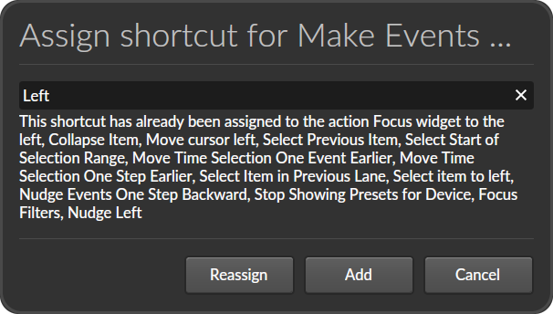

# Shortcuts: Share a Key

> **Built against**: Bitwig 6.1.4 (Windows x64)
>
> **Will map to**: All Bitwig versions Patchbay supports on Windows, Mac and Linux
>
> **Mod ID**: shortcut-share-key
>
> **Prerequisites**: None

## What does this do?

Out of the box, Bitwig will assign the same key to multiple actions. As an example, the Left key moves focus between panels, moves the cursor in a text field and moves a selection in an editor. If you try to assign the Left key to a different action, Bitwig will remove all previous assignments and assign the key exclusively to the new action.

**Shortcuts: Share a Key** adds a third button to the key assignment dialog, **Add**, which allows you to assign a key to an action without losing any assignments that it has already.

## How do you use it?

1. Open **Settings > Shortcuts** and click the plus button to assign a key.
2. Press a key that has already been assigned to another action. The dialog will show the other actions that are already using it.
3. Click the **Add** button. The key will be assigned to the action without losing any previous assignments.

To remove a key, click the X button next to an assignment in **Settings > Shortcuts**. This will remove it without affecting any other key assignments.

## Things to note

* In the case that a key is assigned to multiple actions, there are several rules that govern which action will be used.

  * Bitwig will only ever trigger a single action. It does not trigger multiple actions simultaneously, or cycle through multiple actions that may be relevant, it will pick the action that best fits the situation based on internal rules.

  * Bitwig will choose actions based on the area of the application that is currently focused (focus is determined by the area / panel that is clicked, not just hovered over).

    * If an action directly relates to the area that is focused, Bitwig will trigger that action.

    * If no action directly relates to the area that is focused, it will move to the panel the area belongs to and trigger an action based on that.

    * This continues until an action is found and triggered.

  * If more than one action still fits the scenario:

    * An action limited to a specific situation will be chosen over a general one.

    * Otherwise, Bitwig will choose the action that was registered last.

      * This does not mean the action the key was assigned to last, but rather when the action was registered within Bitwig. As actions for mods are registered after Bitwig's stock actions, this would likely result in mod actions triggering over stock Bitwig actions.

* Any actions assigned using the **Add** button stay after the mod is disabled as a key being assigned to multiple actions is naturally supported by Bitwig.

* The **Add** button will only appear when attempting to assign a keyboard shortcut that has already been assigned. It does not appear for MIDI controller assignments.
